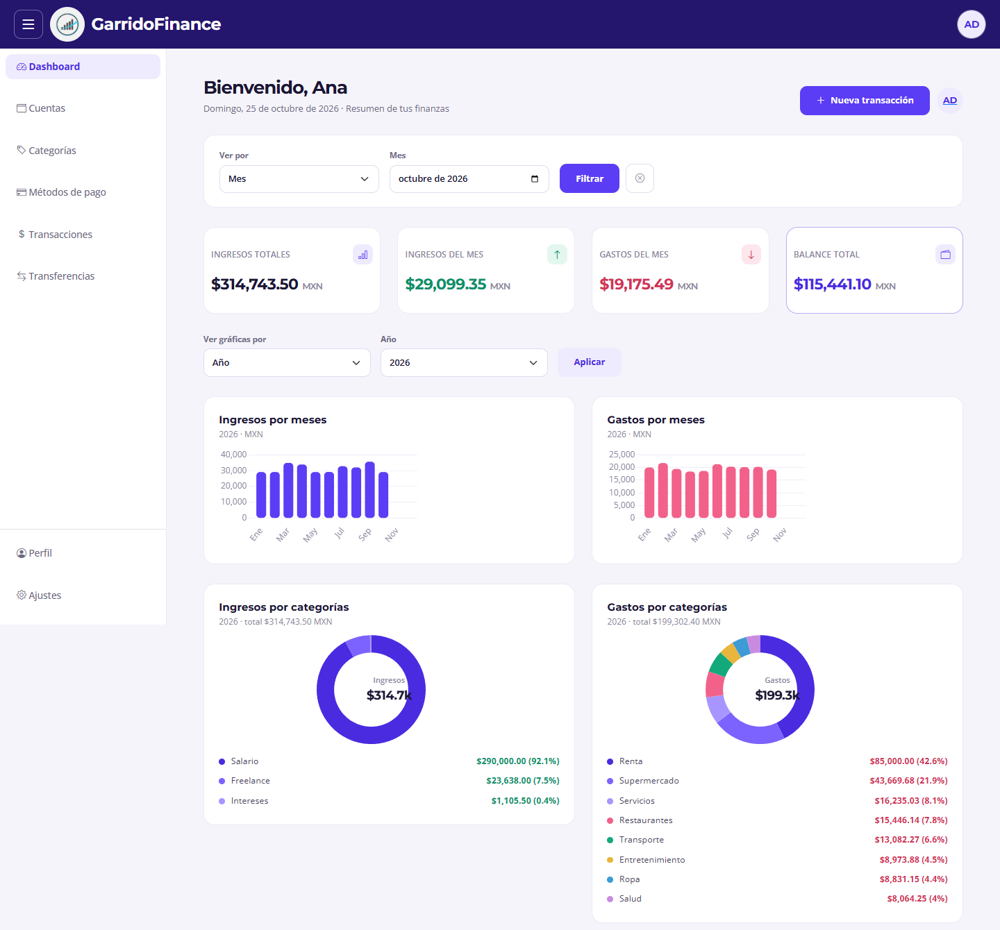
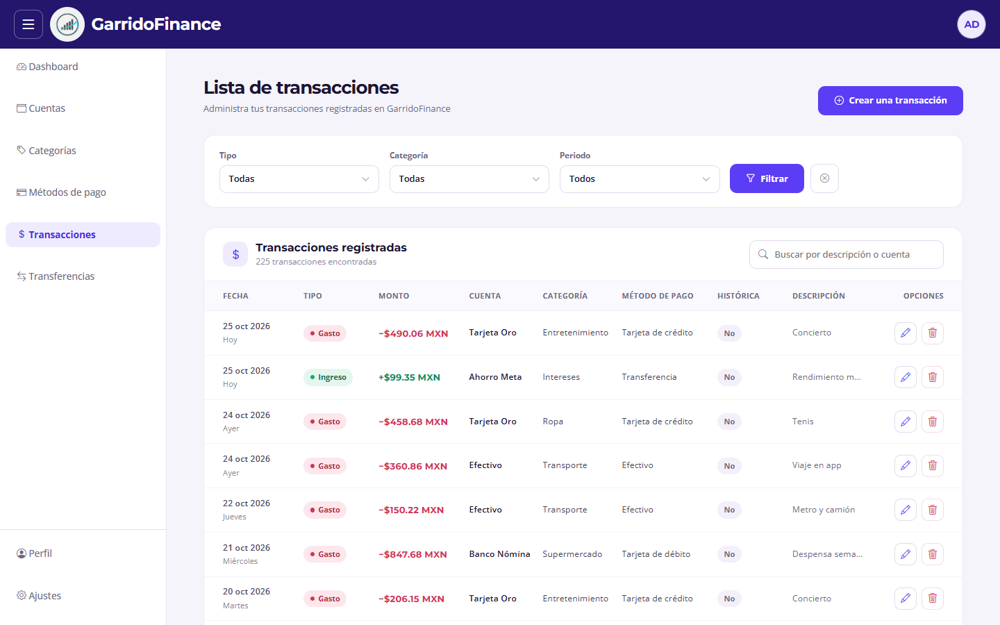
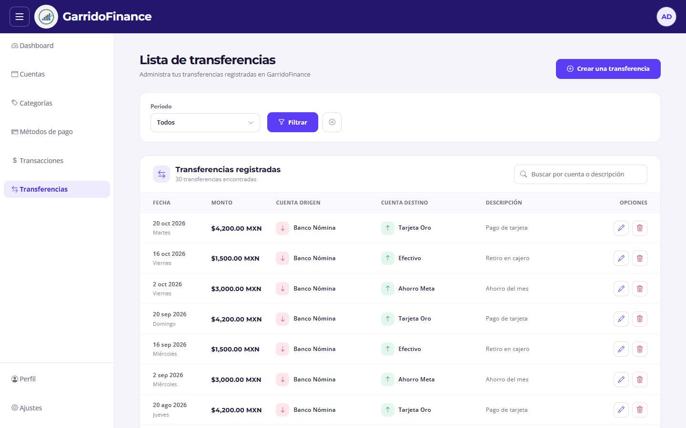
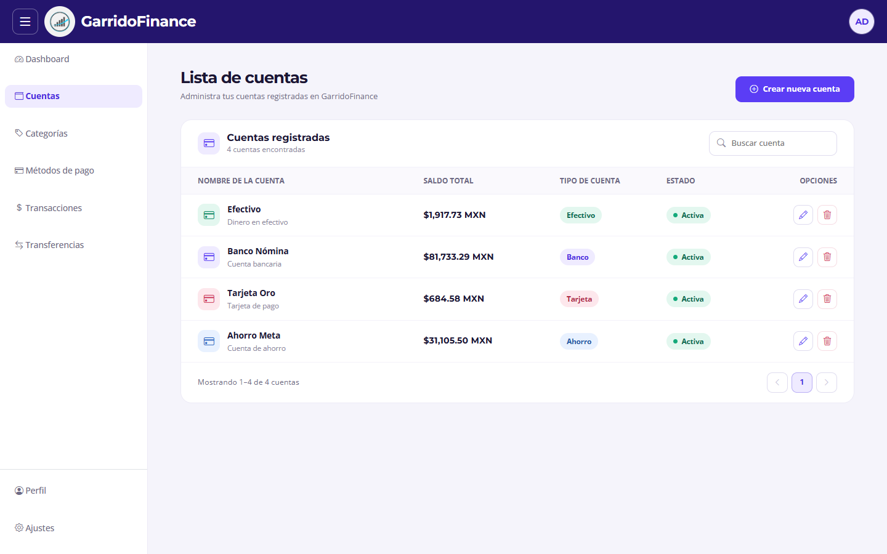
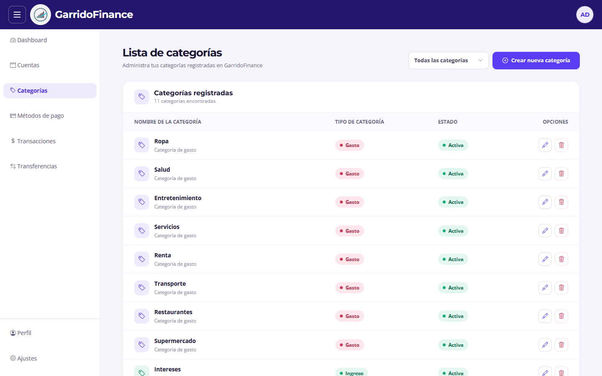
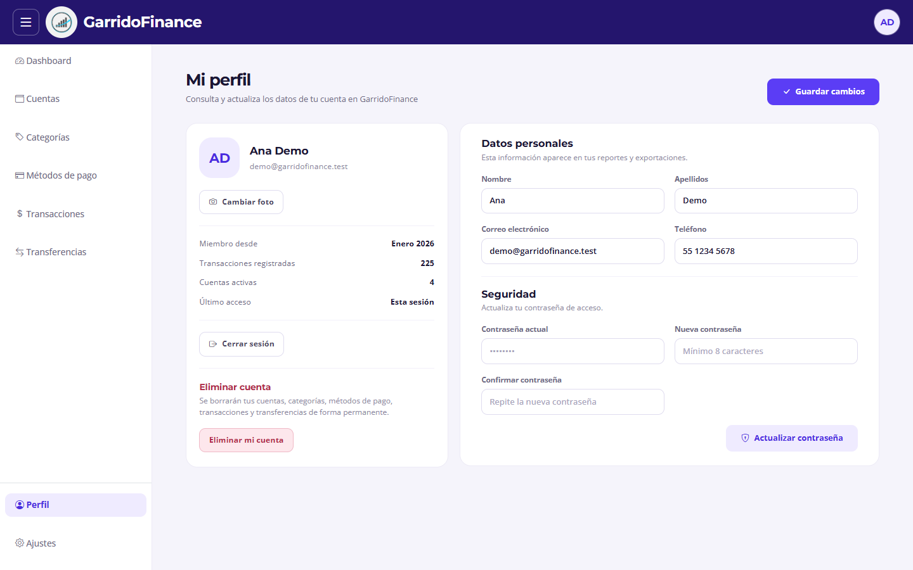
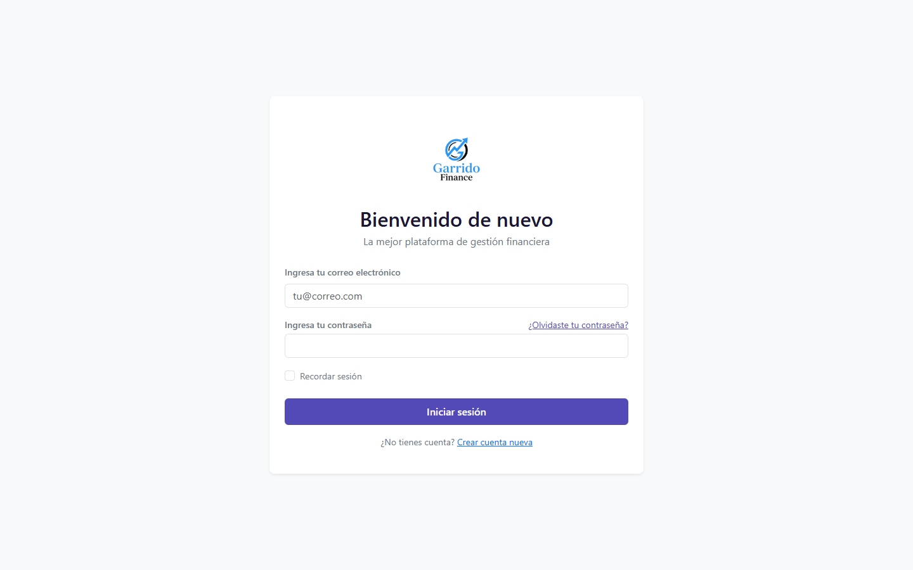

# GarridoFinance

Aplicación web de finanzas personales hecha con Laravel 12. Registra tus cuentas, ingresos, gastos y transferencias, y te muestra en un solo panel cuánto tienes, en qué gastas y cómo cambian tus finanzas mes a mes.



---

## ¿Qué resuelve?

Llevar las finanzas en hojas de cálculo o en notas sueltas hace difícil saber cuánto dinero hay realmente en cada cuenta y a dónde se va cada mes. GarridoFinance concentra todos los movimientos en un solo lugar y calcula el resto:

- **Saldo real de cada cuenta**: efectivo, banco, tarjeta o ahorro. Se calcula a partir de los movimientos, así que nunca se desajusta.
- **Ingresos y gastos por periodo**: semana, mes o año, con gráficas por mes y por categoría.
- **Transferencias entre cuentas propias** (por ejemplo, del banco al ahorro), sin que cuenten como ingreso o gasto.
- **Historial importable desde Excel**, para empezar con los datos que ya tienes.

Está pensada para una persona que quiere controlar su dinero sin depender de una app bancaria. Cada usuario ve solo su información. Los montos están en pesos mexicanos (MXN) y las fechas en español.

## Funcionalidades

| Módulo | Qué permite |
| --- | --- |
| **Dashboard** | Ingresos, gastos y balance total del periodo elegido; gráficas de ingresos y gastos por mes y por categoría; comparativa anual; últimas 10 transacciones y saldo de cada cuenta. |
| **Cuentas** | Crear, editar, desactivar y eliminar cuentas de tipo efectivo, banco, tarjeta o ahorro, con su saldo calculado. |
| **Categorías** | Categorías de ingreso y de gasto, con filtro por tipo. |
| **Métodos de pago** | Crédito, débito, efectivo, transferencia u otros. |
| **Transacciones** | Ingresos y gastos con cuenta, categoría, método de pago y descripción. Filtros por tipo, categoría y periodo (día, semana, mes o año), y búsqueda. |
| **Transferencias** | Movimientos de dinero entre dos cuentas propias, con filtro por periodo y búsqueda. |
| **Perfil** | Datos personales, cambio de contraseña, foto de perfil, resumen de la cuenta y eliminación de la cuenta. |
| **Acceso** | Registro e inicio de sesión, con un límite de 5 intentos por minuto. |

Todos los listados tienen paginación, conservan los filtros al cambiar de página y se manejan con ventanas modales para crear, editar y eliminar sin salir de la pantalla.

### Capturas

| Transacciones | Transferencias |
| --- | --- |
|  |  |
| **Cuentas** | **Categorías** |
|  |  |
| **Perfil** | **Inicio de sesión** |
|  |  |

> Las capturas usan un usuario de demostración con datos inventados.

---

## Stack tecnológico

| Capa | Tecnología |
| --- | --- |
| Backend | PHP 8.2+, Laravel 12 |
| Autenticación | Laravel Fortify |
| Base de datos | MySQL 8 / MariaDB 10.4+ |
| Vistas | Blade, Bootstrap 5.3 y Bootstrap Icons (CDN) |
| Gráficas | Chart.js |
| Fechas | Carbon (en español, zona horaria `America/Mexico_City`) |
| Importación | PhpSpreadsheet |

Es un monolito Laravel que renderiza todo en el servidor con Blade, sin API ni framework de JavaScript. Los estilos y scripts propios están en `public/css` y `public/js` y se cargan directamente, así que **no hace falta compilar assets**. Vite y Tailwind vienen configurados por Laravel, pero no se usan.

## Cómo funciona

- **Multiusuario**: todas las tablas de negocio tienen `user_id`, y cada consulta filtra por el usuario autenticado.
- **Libro de movimientos**: los saldos no se guardan en la base de datos. Cada vez que se consultan se calculan sumando los movimientos:

  ```
  saldo = ingresos − gastos + transferencias recibidas − transferencias enviadas
  ```

- **Validación de pertenencia**: una transacción o transferencia solo acepta cuentas, categorías y métodos de pago del mismo usuario. La categoría debe coincidir con el tipo de movimiento (ingreso o gasto).
- **Catálogos inactivos**: al crear un movimiento solo se ofrecen cuentas, categorías y métodos activos. Al editarlo también aparecen los inactivos, para no perder el valor guardado.
- **Una vista por módulo**: crear, editar y eliminar se hacen en modales dentro del listado. Si una validación falla, el modal se vuelve a abrir con los datos y el error en cada campo.

### Modelo de datos

```
users ─┬─ accounts ─────────┬─ transactions (ingreso / gasto)
       ├─ categories ───────┤
       ├─ payment_methods ──┘
       └─ transfers (cuenta origen → cuenta destino)
```

| Tabla | Rol |
| --- | --- |
| `users` | Dueño de todos los datos |
| `accounts` | Dónde está el dinero: efectivo, banco, tarjeta o ahorro |
| `categories` | Clasificación de ingresos y gastos |
| `payment_methods` | Con qué se pagó |
| `transactions` | Ingresos y gastos |
| `transfers` | Movimientos entre dos cuentas propias |

## Estructura del proyecto

```
app/
├── Actions/Fortify/          # Registro, perfil y contraseña
├── Console/Commands/         # Comando import:transactions
├── Http/Controllers/         # Un controlador por módulo
└── Models/                   # Modelos y trait HasMovementDate (fechas y filtro por periodo)
database/migrations/          # Tablas de la app
public/
├── css/                      # Estilos: style, dashboard, components y uno por vista
└── js/                       # Gráficas del dashboard y filtros
resources/views/
├── layouts/app.blade.php     # Header, menú lateral y contenido
├── components/               # Paginación, filtros, avatar, tarjetas, gráficas
└── <módulo>/index.blade.php  # Una vista por módulo
routes/web.php                # Rutas propias (las de Fortify se registran solas)
docs/screenshots/             # Capturas del README
```

---

## Instalación

### Requisitos

- PHP 8.2 o superior con las extensiones `pdo_mysql`, `mbstring`, `fileinfo`, `gd` y `zip`
- MySQL 8 o MariaDB 10.4+ (por ejemplo, con XAMPP)
- Composer 2

### Pasos

```bash
# 1. Clonar e instalar dependencias
git clone https://github.com/Daniel-Garrido/GarridoFinance.git
cd GarridoFinance
composer install

# 2. Configurar el entorno
cp .env.example .env
php artisan key:generate
```

3. Crea una base de datos vacía (por defecto `sistemafiannzaspersonales`, con cotejamiento `utf8mb4_unicode_ci`) y ajusta las variables `DB_*` del `.env`.

```bash
# 4. Crear las tablas
php artisan migrate

# 5. Enlace público para las fotos de perfil
php artisan storage:link

# 6. Levantar el servidor
php artisan serve
```

7. Abre `http://localhost:8000/register` y crea tu usuario.

> No uses `php artisan migrate --seed`: el `DatabaseSeeder` todavía depende de factories que no existen.

### Variables de entorno relevantes

| Variable | Valor por defecto | Nota |
| --- | --- | --- |
| `DB_DATABASE` | `sistemafiannzaspersonales` | Nombre de la base de datos |
| `SESSION_DRIVER` | `database` | Se usa para mostrar el último acceso en el perfil |
| `CACHE_STORE` | `database` | Guarda el límite de intentos de inicio de sesión |
| `MAIL_MAILER` | `log` | Los correos no se envían; se escriben en `storage/logs` |
| `APP_DEBUG` | `true` | Cámbialo a `false` en producción |

## Importar movimientos desde Excel

El comando `import:transactions` carga un histórico desde un archivo `.xlsx` y crea las cuentas y categorías que falten.

```bash
# Probar sin guardar nada
php artisan import:transactions ruta/al/archivo.xlsx --dry-run

# Importar para un usuario concreto (por defecto, el primero)
php artisan import:transactions ruta/al/archivo.xlsx --user_id=1
```

El archivo se lee desde su hoja activa, y la primera fila debe ser el encabezado:

| Columna | Ejemplo | Interpretación |
| --- | --- | --- |
| Fecha | `31/10/2026` | Formato `d/m/Y` |
| Tipo | `Gasto`, `Ingreso`, `Transferencia` | Las transferencias van a su propia tabla |
| Categoría | `Restaurante` | Se busca o se crea; vacía → "Otros" |
| Detalles | `Cena con amigos` | Descripción |
| Cuenta | `Efectivo` o `Banco > Ahorro` | En transferencias, origen y destino separados por `>` |
| Monto | `2,500.00` | Se ignoran las comas de miles |

Toda la importación corre en una sola transacción: si una fila falla, no se guarda nada. El comando no detecta duplicados, así que importar dos veces el mismo archivo duplica los movimientos.

## Comandos útiles

| Comando | Para qué |
| --- | --- |
| `php artisan route:list --except-vendor` | Lista las rutas propias |
| `php artisan view:clear` | Limpia las vistas compiladas si un cambio de Blade no se refleja |
| `php artisan migrate:fresh` | Borra y vuelve a crear todas las tablas (**se pierden todos los datos**) |
| `vendor/bin/pint` | Da formato al código PHP |

---

## Estado del proyecto

El MVP está entre 80 % y 85 %: toda la funcionalidad principal existe y tiene su diseño final. Falta lo siguiente para darlo por terminado:

- [ ] Comprobar que el registro pertenece al usuario al editar y eliminar
- [ ] Evitar que borrar una cuenta, categoría o método de pago elimine sus movimientos
- [ ] Vistas para recuperar la contraseña y configuración de correo
- [ ] Limitar las rutas de recursos a las que tienen vista
- [ ] Mensajes de validación en español (`APP_LOCALE=es`)

**Después del MVP:** pantalla de ajustes (moneda, idioma, formato de fecha), verificación en dos pasos, exportación a CSV y presupuestos por categoría con alertas.

## Autor

**Daniel Garrido** · [GitHub](https://github.com/Daniel-Garrido) · [Repositorio](https://github.com/Daniel-Garrido/GarridoFinance)

## Licencia

Distribuido bajo la licencia [MIT](https://opensource.org/licenses/MIT).
